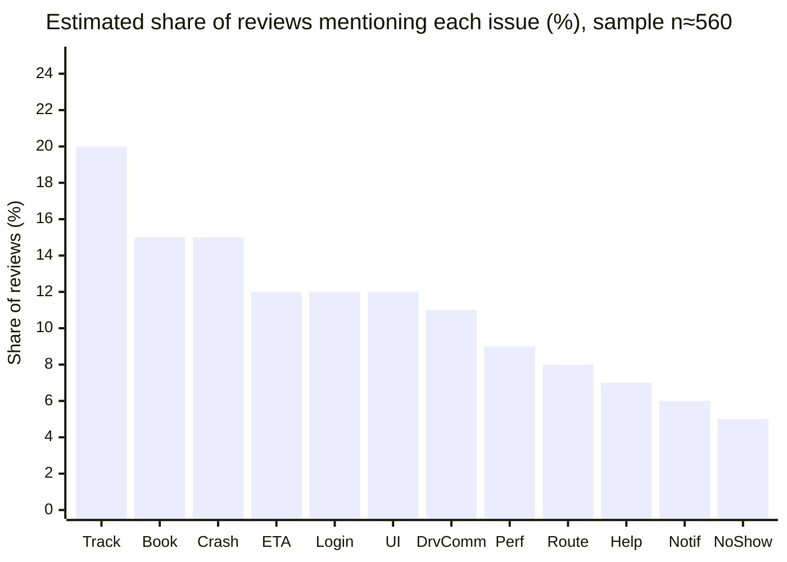
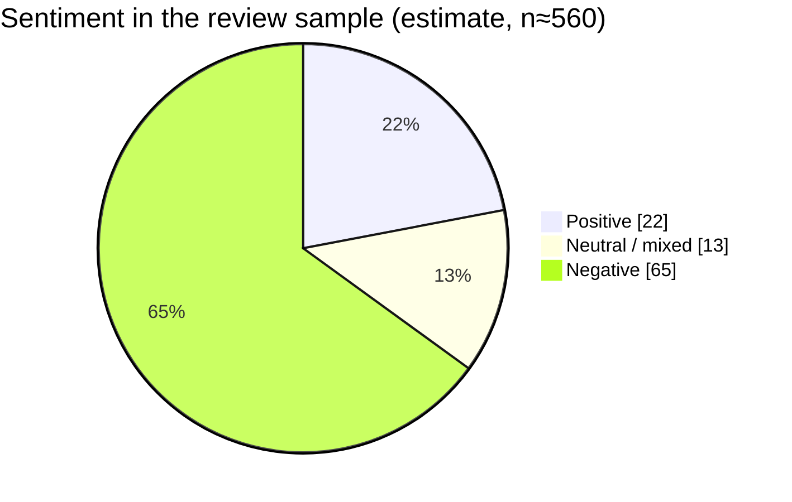
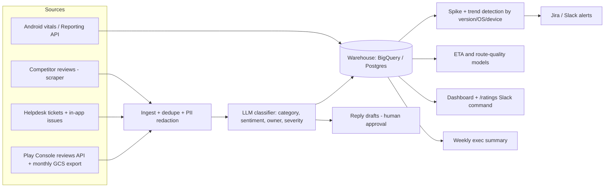
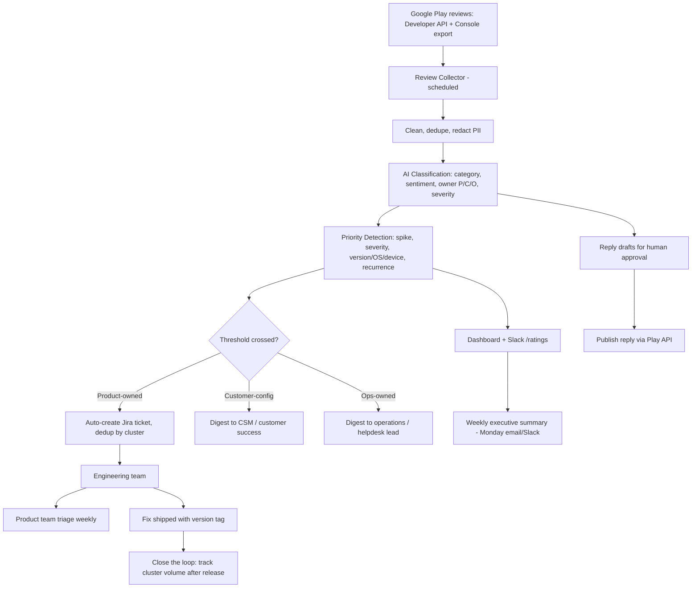

<div style="text-align:center; padding-top:120px">

# Improving MoveInSync Play Store Ratings
## Evidence-Based Product & Engineering Recommendations

**Prepared by:** Bukke Giridhar Naik
**Role applied for:** Forward Deployed Engineer (Intern to FTE)
**Prepared for:** MoveInSync CTO, Product Head, Engineering Team
**Date:** 11 October 2026
**Data source:** Public Google Play listing for *MoveInSync: Enabling Hybrid Workplaces* (store page captured 8 Oct 2026)

</div>

<div style="page-break-after: always"></div>

> **How to read this report.** Everything below comes from the public Play Store review text I collected. Counts are **hand-coded estimates on a sample, rounded to the nearest 5**, not exact figures (see Section 3). Anything I could not observe is labelled **[ASSUMPTION]** or **[HYPOTHESIS]**. Hypotheses about root cause need to be confirmed against your logs, crash data and release history. I did not have access to those.

---

## 1. Executive Summary

**Where the app stands (store page, 8 Oct 2026)**

| Metric | Value |
|---|---|
| Play Store rating | **4.6** |
| Total ratings/reviews | **~1.15 lakh (≈115,000)** |
| Downloads | **10 lakh+ (1M+)** |
| Reviews analysed | **≈560 distinct reviews** (sample), spanning 2018 to Sep 2026 |

**What the sample says, in one paragraph.** The 4.6 average is a lifetime figure and hides a different story in the recent text. Roughly two thirds of the reviews I read are negative, and the loudest complaints are not about the idea of the product. They are about **the app failing at the exact moment the employee needs it**: standing at the pickup point, cab arriving, phone showing a stale location, a blank screen, an OTP that never arrives, or a forced logout. Since about April 2026 a cluster of **launch/login failures** has appeared that is new in character and severe.

**Biggest problems (ranked by estimated share of reviews that mention them)**

1. **Live tracking and ETA are untrustworthy** (~30% of reviews touch tracking, GPS or ETA). Stuck cab icons, ETA jumping from 5 to 30 minutes, "location 1 to 2 hours old", map auto-zooming out. Several of these were acknowledged in public replies in 2019, 2024 and 2025 and still appear in 2026.
2. **App will not open or reinstalls itself** (~15%). The "app not installed from Play Store" error, blank screens, crash after auto-update, the reinstall-as-workaround pattern. About a dozen reviews from Jun to Sep 2026 describe the same installer-check error.
3. **Login, OTP and sessions** (~12%). OTPs not received on SMS, WhatsApp or email (some users report 7 days or ~50 attempts), plus forced re-login every few minutes to days. Forced logout also locks users out of cab number, driver contact and **SOS**.
4. **Booking and scheduling logic** (~15%). Bookings that fail, vanish, duplicate, land on the wrong date, or cannot be cancelled. No non-consecutive multi-date booking for hybrid workers.
5. **Unfair "No Show"** (~5% but extremely high emotion). Users marked No Show while at the pickup point or after the app misled them, with salary deductions mentioned.
6. **No in-app driver communication** (~10%). Calls disabled by policy, calls drop, no chat. Basement pickups with no network make this worse.
7. **Notification and interrupt fatigue** (~6%), **forced feedback** (~4%), **transport-policy pop-up on every open** (~2%).

**Top opportunities**

- Fix the **P0 "cannot open / cannot log in" cluster** first. These are 1-star reviews that no UX polish can offset.
- Make **tracking honest**: show data freshness, stop auto zoom-out, stabilise ETA.
- **Close the loop on reviews.** Recent reviews are almost entirely unanswered, and older replies often redirect users to "your transport manager" even when the defect is in the app.
- Build the reusable **Review Intelligence Pipeline** (Section 12) so "How are our Play Store ratings?" gets answered by a dashboard, a Slack command and a weekly summary, not a one-off analysis.

**Expected impact (stated honestly)**

- The lifetime average moves slowly. With ~115,000 existing ratings at 4.6, lifting the lifetime average to 4.7 needs roughly **57,500 new ratings averaging 4.9** (my arithmetic, Section 14). So track the **rolling 30/90-day rating and 1-star share** as the working KPI. Google's displayed rating is reported to weight recent ratings more heavily **[verify in Play Console]**.
- **[ASSUMPTION]** If the P0 and P1 fixes land, I expect the rolling 90-day average to improve noticeably and 1-star volume to fall. I deliberately do not put a point estimate on it without Android vitals and star histogram data. Section 14 defines how to measure it from week 0.

---

## 2. Assignment Objective

**Business problem.** MoveInSync's value is a promise: the employee books a ride, the system assigns and routes it, and the app tells them truthfully where the cab is and when to walk out. The Play Store rating is the public scorecard of whether that promise holds at the moment of use.

**Why ratings matter here (and not only for installs)**

- **Distribution is mandated, not chosen.** Many users say they use the app only because their employer requires it ("I have no other option"). Ratings therefore influence less of the install funnel than in consumer apps, but they strongly influence **enterprise buyer perception**. One reviewer explicitly addresses "the companies who hire MoveInSync". Another writes that companies "should avoid" the service. Reviews are read by transport heads and procurement teams of 430+ customers.
- **Reviews are an unfiltered ticket queue.** Employees say they tried email, helpdesk and in-app bug reports first and came to Play Store because nothing acknowledged them. That makes reviews an early-warning system for production issues.
- **Poor app experience converts into operational cost.** A missed pickup from a stale ETA becomes a helpdesk call, a No Show dispute, a rebooked cab, and a lost trust event with the employer.
- **Credibility risk.** Several reviews say the 4.6 "can't be genuine". A gap between visible rating and lived experience is a reputational risk by itself (see R11).

---

## 3. Research Methodology

**Data.** The assignment says data is publicly available. I used the public Google Play listing, captured as page text on 8 Oct 2026: app metadata (rating, review count, downloads), reviewer name, date, review text, "helpful" counts and the developer's public replies. Star ratings per review and the star histogram were **not captured** in the page text.

**Process**

1. **Cleaning.** Removed duplicate captures (the first three reviews appear twice with different helpful counts), normalised dates, separated developer replies from reviews.
2. **Coding.** I read every review and tagged it with one or more categories from a fixed taxonomy (Section 5), plus a **sentiment** (Positive / Neutral-Mixed / Negative) and an **owner** tag:
   - **P** = product/engineering owned (app behaviour, backend)
   - **C** = customer-configured (cut-offs, passenger list visibility, calling, rating prompts are set per organisation, according to developer replies)
   - **O** = operations/vendor owned (driver behaviour, helpdesk, route planning decisions)
3. **Counting.** Counts are multi-label, rounded to the nearest 5, and carry roughly **±20% error** from manual coding. They are good for ranking, not for reporting to two decimals. The pipeline in Section 12 replaces this with exact, reproducible counts.
4. **Prioritisation.** Each issue was scored on four things: **customer impact** (severity and whether it blocks the core journey), **frequency** (share of reviews, recurrence over years), **business impact** (rating, churn risk, ops cost, safety) and **engineering effort and feasibility** (S/M/L). Blocking issues (cannot open, cannot log in) rank above annoyances regardless of frequency.
5. **Time-slicing.** I compared eras (2018-19, 2020-23, 2024-25, 2026) to find recurring versus new problems.

**Assumptions and limits**

- **[ASSUMPTION]** The sample is the most-relevant/most-recent slice Play shows, so it is **skewed negative** relative to the full 1.15L base. I do not extrapolate sentiment to the whole population.
- **[ASSUMPTION]** "Lower than they should be" means the recent trend and negative review tone are worse than the 4.6 headline suggests. I could not verify the 30/90-day rolling rating.
- **[ASSUMPTION]** Reviews attributed to features (tracking, call, passenger list) are generally accurate, but reviewers sometimes confuse app, vendor and employer. I handle this with the owner tag.
- Review text from the Play Store contains names and employers. For the production pipeline I recommend redaction before any LLM call.

---

## 4. Dataset Overview

| Item | Value |
|---|---|
| Current rating | 4.6 (store page) |
| Review volume (store) | ~1.15 lakh |
| Downloads | 10 lakh+ |
| Last app update shown | 8 Oct 2026 |
| Sample size analysed | ≈560 distinct reviews **(estimate)** |
| Review time range | 2018 to 17 Sep 2026 (a handful of developer replies carry older timestamps, probably from account or domain migrations) |
| Share of sample dated Apr to Sep 2026 | ≈40% **(estimate)** |
| Positive / Neutral-Mixed / Negative | ≈22% / ≈13% / ≈65% **(estimate, text-based)** |
| Reviews with a developer reply | ≈35% overall, but **almost none in the 2026 slice** |
| Store data-safety flags | "No data shared with third parties"; collects location and personal info; "Data can't be deleted" |

---

## 5. Review Analysis

Each category lists: summary, representative themes, customer pain, engineering impact, business impact, priority and owner. Reviewer names and dates are given so you can find the originals.

### 5.1 Launch failure, crashes, "not installed from Play Store" (**P0**, owner P)
- **Summary.** The app fails to open, shows a blank screen, closes in a second, or throws "app not installed from Play Store / not downloaded from app store". Typical workaround reported: uninstall and reinstall, which then works for 2 to 3 days or ~48 hours.
- **Themes.** Govindaraj K (30 Jul 2026), Pratik Gadge (9 Aug), Aakash Kumar (6 Aug), Sheetal Sorout (30 Jul), kurakula dayakar (13 Aug), Vishal Gomes (29 Jul), Santosh Kumar Pal (14 Jul), N (3 Aug), Sushmitha Ravindra ("keeps uninstalling", 1 Aug). Ayan Bhattacharya (10 Aug): the app launches fine until it auto-updates and then does not. Android 14 / Android 17 / OnePlus 13 / Pixel 6a reports exist too (shailesh pal, Byategowda VG, Vinayak Kale, Hemant singh).
- **History.** A similar false error in 2023 ("does not work on rooted device" on a non-rooted Pixel 7, fixed in v11.4.7) suggests **client-side integrity/installer checks that misfire**.
- **Customer pain.** Cannot see cab number, OTP or location while the cab is waiting.
- **Engineering impact.** **[HYPOTHESIS]** Installer-source or integrity verification (Play Integrity, root/tamper detection, signature check) failing after auto-update, split-APK or key-rotation issues, or a bad staged rollout. Verify in Android vitals by app version and OS.
- **Business impact.** Hard 1-star driver; erodes trust at the exact moment of use.

### 5.2 Login, OTP and session (**P0**, owner P, partly C)
- **Summary.** OTP not delivered on SMS, WhatsApp or email; OTP box not rendered on some OS versions; forced re-login every 5 to 10 minutes or on each open.
- **Themes.** Dhiraj Nathani (9 Sep 2026), Manuel Lacanlale (4 Sep), Saurabh S. (2 Sep), Himanshi Jeenwal (2 Sep), Vyshnavi B (1 Apr), Goli Nagamalleswararao ("nearly 50 times", 22 Apr), Innocentia Dike ("7 days", 6 Apr), Naveen Kumar (8 Jan: no message telling whether the number is even registered). Forced re-login: Rayan D'Souza (13 May 2026), Kalyan (23 Dec 2025), Nagesh Buyre, Paras Domadiya, Samudrala Dheeraj, Pranay Asadhi, Parimal Jain. Positive counterexample: adal cardo (7 Aug 2026) praises OTP over WhatsApp.
- **Customer pain.** Total lockout. Rayan's review raises a **safety** issue: women trying to send an SOS get force-logged-out and must re-authenticate through the company app.
- **Customer-config note.** Developer replies say OTP login is an org-mandated 2FA requirement. That explains frequency of OTP, but not **non-delivery** or the **lack of device-bound session**.
- **Engineering impact.** SMS/WhatsApp/email provider reliability and fallback, token TTL, refresh-token handling, no biometrics or remembered device.

### 5.3 GPS and live tracking (**P0/P1**, owner P with O dependency)
- **Summary.** The headline feature is also the #1 complaint, and the #1 compliment ("tracking is excellent and accurate" appears many times in 2026). That split suggests **inconsistent quality by organisation, device, network or driver app**, not a universal failure.
- **Themes.** Cab icon frozen 10 to 30 minutes (Garima Deswal, Shaik Arshad, Shekhar S); location shown "one or two hours ago" (SWASTIK TRIPATHI, 10 Aug 2026); cab "suddenly shows up at your location" (Lettinthang Haokip); tracking unavailable before a time window (users cite 240 minutes); tracking unavailable with an error even after trip start (Girish Bhat); chosen pickup pin differs from what the driver gets (Savitha Sathyan, Thippesh Km, Bharat Simha Reddy).
- **Recurring defect: map auto-zoom-out.** Reported in 2019 (several), 2024 (Rohit Mukherjee, vatsal shah, Jinen Konjengcha), Nov 2025 (Vinayak Phal), 2026 (ಸತೀಶ್ ಕುಮಾರ್). Developer replies acknowledged it in 2019, Jan 2024 and Nov 2025. It is still reported.
- **Engineering impact.** Driver-device GPS cadence and connectivity (an older reply says some driver devices used 2G), server-side stale-position handling, map camera logic, caching in the app.
- **Business impact.** Direct cause of missed cabs, driver-passenger conflict and No Show disputes.

### 5.4 ETA and pickup-time reliability (**P1**, owner P/O)
- **Summary.** ETA flips by large margins (5 to 30 min: Manasa H; "app shows 1 hour, driver says 5 minutes": John Smith, 13 Jun 2026; Prakhar Verma; Shaik Arshad asks MoveInSync to **stop showing ETAs** if they cannot be accurate). Planned pickup times shift day to day for the same cab-mates (Nitin Pandey, utkarsh lath, Vijay Thadkal, Sandeep Kr. Rana).
- **Engineering impact.** ETA model (traffic, stops remaining, dwell time), ETA shown as single point with no confidence, rerouting and re-clubbing causing pickup-time changes without notification.

### 5.5 Booking and scheduling (**P1**, owner P with C)
- **Summary.** Failures at roster open (high concurrency), bookings that do not appear in "My bookings", duplicates, wrong dates, no cancel/edit for waitlisted or on-pickup trips, lack of non-consecutive multi-date selection.
- **Themes.** "Dates created for different dates" (Nontsikelelo Candice, 18 Jun 2026); Sunday booking defaulting to Tuesday instead of Monday (Pratyusha Ghosh, 11 May 2026); bookings missing from list while travel desk confirms they exist (Rahul menon, TheProperDog101, Lorilie Canete); waitlisted users blocked from cancel/rebook (Senyorita, Lalaine, Nath Nath, NAOMI); freeze when many users book at once (Manoj Kumar S, Joem LZD, Raviraj P). Hybrid users want Mon/Wed/Fri booking (TAMAL MAJUMDER, Shaun, Ankush Comm). Shuttle booking turned 2 steps after a redesign and caused a user to believe a cab was booked (Lakshya Bang, 7 Jul 2026).
- **Engineering impact.** Booking write path not idempotent or not confirmed end-to-end, list view out of sync with backend, concurrency at schedule release, date defaults.

### 5.6 UI and UX (**P1/P2**, owner P)
- **Summary.** Redesign regressions: lost colour coding, hidden passenger list, tiny calendar, ambiguous Login/Logout order (Pavan Yoboy: "Logout and Login" vs "Login and Logout" leading to No Shows), too many taps and dropdowns, confusing error messages, poor first-time guidance (brock singh, 20 Apr 2026). Mixed: several 2026 reviews call the new UI "simple, easy" while others call it "modern but not simple" (Abhinav Jain). **The release itself, not the design direction, seems to be the issue** (Lakshya: "better to release than throw them in the user's face").
- **Engineering/Product impact.** Needs UX regression gates, feature flags, staged rollout, in-app change explanation.

### 5.7 Performance and startup (**P1**, owner P)
- **Summary.** 10 to 20 seconds to load (Kanthala Raghu: "20 seconds"), splash animation, full-screen banners (Ankit Rathi: "earth month" banner), festive pop-ups, and **transport policy "I agree" on every open** (P Dilip Kumar, Dileep Nelli, Yuvaraj D: "500 times", Pradyumna Kammardi, atul nath, Sourabh Panse). Heavy battery/background use (Praveen Cimplicity).
- **Fix class.** Remove blocking interstitials from the critical path; cache last trip state; acceptance once per policy version.

### 5.8 Network failures and offline behaviour (**P1**, owner P)
- **Summary.** "No network" on stable connections; works on Wi-Fi but not mobile data (suraj kumar, Sep 2026) or the reverse (Roxal Nirwan, shashank rana on Airtel Wi-Fi). This is a **recurring pattern from 2022 (Ansh Sharma, Meghala Panicker) to 2026**.
- **Offline.** Sailesh Sunkara (Jan 2026) lost driver details and OTP when signal dropped at the gate. Basement pickups (Karthik Mohan, Deepak Sonar) have the same issue. Developer replied that tracking cannot be done offline, which is right, but **static trip data (cab number, OTP, driver) can be cached**.
- **Hypothesis.** DNS/IPv6/CDN/proxy or certificate-pinning issues on specific ISPs; unmanaged timeouts mapped to the same "no internet" message.

### 5.9 Notifications and interruptions (**P1/P2**, owner P)
- **Summary.** Too many (10x "Cancel login and avoid being a no show": Akash Balaji; delay pop-ups every few minutes: Prateek Goyal; notifications after trip completion: Tushar Gaur; Play Store review prompt after every ride: Antony Peter; popups blocking even the SOS button: Swapnil Deore). Also **wrong, late or missing** (Muthusamy A, Anshul Rawat, Jigyasa Choudhary). Forced notification permission (Tushar Chib).
- **Impact.** Notification trust is a precondition for the "smart reminder" features users request (check-in reminder, daytime parking reminder, 5-minute-before timer).

### 5.10 Driver communication (**P1**, owner P/C)
- **Summary.** One of the most-requested features across years. Call disabled by company policy (Prasanna, 16 Jul 2025; brock singh), calls disconnect after one ring or have poor audio (Anuj Jain), numbers show as spam (Ganesh Patil, 2023), drivers' calls do not connect to users (Rahul Saini). Users ask for **chat or canned messages**: Pakhi Mehra (37 helpful), Abhishek Chaudhary (221 helpful, 2022), Caleb Sam, Gaurav Garg, Akshay Varshney, Deepak Sonar ("I'm in the basement near pillar X").
- **Tension.** Some users complain that the app **forces microphone permission** while only opening the dialer (kanchan kumar, 3 Aug 2026; shahid raza, 2024). In-app chat/templated messages would avoid mic needs altogether.
- **Developer replies.** Earlier replies cited safety reasons for hiding driver numbers and "we are working on" chat (2022). It is still absent.

### 5.11 Pickup experience and No Show (**P0/P1**, owner P+O)
- **Summary.** No Show is a financial and disciplinary event. Reviews describe being marked No Show when: the app showed the wrong location (shivam pande), the cab ETA was wrong (John Smith), timings changed unannounced (Jay, Oct 2025), the driver never came (Devyash Pundir, 21 Jul 2026: waited 2+ hours, marked No Show), QR boarding succeeded but the app later marked No Show (kanishk aggarwal, Rakesh Rao Aroor), and a confirmed booking was cancelled by someone else (manoj kulkarni). Users also ask for a **late-night call before No Show for women** (Dishika Anthoney) and a **self "not travelling" button** so drivers do not wait (Thameem Ansari, Prashant Kale).
- **Owner tag.** Mostly P (state sync, evidence) plus O (driver behaviour). The fixes are cheap compared to the trust cost.

### 5.12 Routing, clubbing and pickup scheduling (**P1/P2**, owner O with P engine)
- **Summary.** Long detours, opposite-direction clubbing, wide pickup windows, 1.5 hours to travel 10 minutes (shubham kumar, Aug 2026), 2.5 hours home vs 50 minutes (banoori bharath reddy, Diwesh Sharma), same-building pickups spaced 5 minutes apart (utkarsh lath, Vijay Thadkal).
- **Developer position.** Earlier replies state routing is the customer's transport policy. A reviewer disputes that logic ("If you're on a straight line with other pickups, the route is optimised", Vikram Rathi).
- **Actionable angle.** Whatever the policy, the engine can **expose detour metrics and flag outliers** to customers.

### 5.13 Customer support and helpdesk (**P1**, owner O)
- **Summary.** Helpdesk always busy, disconnects, rude agents (Riddhi Gupta, Neha, Anubhav Paliwal, suraj tiwari, komal Agrawal), no ticket status in app (Amritha Sundar: no way to know if the request reached; Suman Das: no option to raise a ticket), emails unanswered (Sanjna Nair, Deepak Kushwaha: "Do you even read the comments?").
- **Developer reply pattern.** Most older replies end with "write to app@moveinsync.com" and many add "contact your transport facility manager". Reviewers read this as deflection. 2026 reviews have almost no replies.

### 5.14 Co-passenger and pickup transparency (**C/P**, P2)
- **Summary.** Users want to see who is in the cab and sequence (Khan Najib, Kishor Kumar, heena gandhi, Badhrish Srinivasan, Lakshya Bang (the reverse: wants to see only *their* cab)). Replies state the **organisation disabled the passenger list**. Fix is productisation: privacy-safe defaults (first name or initials, area, pickup order), clearer message "your organisation has turned this off".

### 5.15 Safety (**P0 as an enabler, otherwise P1/P2**)
- **Positive.** SOS and OTP boarding are valued (Sumudu Madushanka, Syed Quadri, Varsha).
- **Negative.** SOS reachable only if logged in (Rayan); SOS misclicks while scrolling (Sudharshaun, 2024); pop-ups blocking SOS (Swapnil Deore); seat-belt confirmation seen as ineffective (Mehadi Abbas); overcrowded rear seats and a 12-seater for 3 people (Hussain Sarangpurwala, Marilynn Kalure); rude/abusive drivers (Farhaz Watson); no late-night call for women before No Show.

### 5.16 Permissions (**P2**, owner P)
- Mandatory location even for QR scan and booking (prasanna rao, Arpit Sharma); mandatory microphone (above); forced auto-timezone (King Jr, Deejay Deej); forced notifications (Tushar Chib). These appear in few reviews, but are **high-friction and low-effort to review** and carry a privacy-trust cost given the "data can't be deleted" flag on the listing.

### 5.17 Rating and feedback flow (**P1**, owner P/C)
- **Forced feedback with no skip**, sometimes twice for the same trip (MD, Guru B, Alamin Abdul Raheem, Jigar Gala, jollie anne); a feedback form that blocks keyboard suggestions; reviewers who **cannot rate** at all because their org disabled it (Nitin Garg).
- **Important unverified claim.** Ranveer Mendigire (16 Jul 2026) says the in-app rating only offers 4 or 5 stars. Neha and Riddhi Gupta write "don't believe the high ratings". **[HYPOTHESIS]** If an in-app flow filters low ratings away from the Play Store, it conflicts with Google's rating guidelines and damages credibility. Verify immediately (R11).

### 5.18 Other
- **Desk/parking booking** (about 3% of the sample): parking slots shown as waiting for one person but available for a colleague (Deepak Kushwaha), date field greyed until slots are full (Vandana Dhanak), desk allocation dropping off (Prashant Joseph).
- **Competitor mentions** (useful for benchmarking): Uber, Ola, Rapido, Routematic, EFMFM.
- **Positive themes** (≈22% of the sample): simple booking, "real-time tracking is the USP", no ads, polite drivers, SOS, WhatsApp OTP.

---

## 6. Complaint Frequency Analysis

Counts are approximate multi-label mentions out of ≈560 reviews, rounded to nearest 5, ±20%. **Estimates from a sample, not exact.**

| Rank | Category | Approx. mentions | Share | Owner | Blocks core journey? |
|---:|---|---:|---:|---|---|
| 1 | Live tracking / GPS / location accuracy | 110 | ~20% | P/O | Partly |
| 2 | Booking / scheduling failures and logic | 85 | ~15% | P/C | Yes |
| 3 | App will not open / crash / blank / installer error | 85 | ~15% | P | **Yes** |
| 4 | ETA and pickup-time instability | 70 | ~12% | P/O | Partly |
| 5 | Login / OTP / forced logout | 70 | ~12% | P/C | **Yes** |
| 6 | UI/UX confusion and redesign regressions | 70 | ~12% | P | Partly |
| 7 | Driver communication (call/chat) | 60 | ~11% | P/C | Partly |
| 8 | Slow load / performance | 50 | ~9% | P | Partly |
| 9 | Routing / clubbing quality | 45 | ~8% | O | No |
| 10 | Helpdesk / support | 40 | ~7% | O | No |
| 11 | Notifications (spam, late, forced) | 35 | ~6% | P | No |
| 12 | No Show disputes | 30 | ~5% | P/O | Partly |
| 13 | Missing co-passenger / sequence info | 25 | ~4% | C | No |
| 14 | Forced / duplicate feedback | 25 | ~4% | P/C | Yes (blocks screen) |
| 15 | Network ("no internet") / offline | 20 | ~4% | P | **Yes** |
| 16 | Driver behaviour / vehicle ops | 20 | ~4% | O | No |
| 17 | Safety concerns | 15 | ~3% | P/O | Yes (SOS) |
| 18 | Transport-policy pop-up each open | 12 | ~2% | P | No |
| 19 | Permissions | 10 | ~2% | P | No |

**Text chart (share of reviews, estimated)**

```
Tracking/GPS           ████████████████████ 20%
Booking                ███████████████ 15%
Launch/crash/install   ███████████████ 15%
ETA/pickup time        ████████████ 12%
Login/OTP/session      ████████████ 12%
UI/UX                  ████████████ 12%
Driver comms           ███████████ 11%
Performance            █████████ 9%
Routing                ████████ 8%
Helpdesk               ███████ 7%
Notifications          ██████ 6%
No Show                █████ 5%
```

**Same data, as a chart (renders in GitHub, GitLab, VS Code, Obsidian):**



**Heatmap: when each problem shows up (qualitative intensity from the sample: ■ low, ■■ medium, ■■■ high, · none/rare)**

| Issue | 2018-19 | 2020-23 | 2024-25 | 2026 (Apr to Sep) |
|---|:--:|:--:|:--:|:--:|
| Tracking / GPS stale | ■■■ | ■■ | ■■ | ■■■ |
| ETA wrong / jumping | ■■■ | ■■ | ■■ | ■■■ |
| Map auto zoom-out | ■■ | · | ■■ | ■ |
| App won't open / blank | ■ | ■■ | ■■■ | ■■■ |
| "Not installed from Play Store" | · | ■ (rooted false positive, 2023) | · | ■■■ |
| OTP not delivered | ■ | ■■ | ■■ | ■■■ |
| Forced re-login | · | ■ | ■■■ | ■■ |
| Call driver fails / no chat | ■■■ | ■■ | ■■ | ■■ |
| Co-passenger list missing | ■■■ | ■■ | ■ | ■■ |
| Forced/duplicate feedback | · | ■■ | ■■ | ■ |
| Notification spam | ■ | ■ | ■■ | ■■■ |
| Booking failures | ■■ | ■■ | ■■ | ■■■ |
| No Show disputes | ■ | ■ | ■■ | ■■ |
| Mandatory permissions | ■ | · | ■■ | ■■ |

**Reading the heatmap.** Tracking, ETA and driver communication are **chronic**: the same complaints for 7 years. Launch, OTP and notification problems are **acute and rising in 2026**. Chronic problems cap the rating; acute ones drag the current rating.

---

## 7. Sentiment Analysis

Text-based classification (star values were not in the captured page).

| Sentiment | Share (estimate) | What it sounds like |
|---|---:|---|
| Positive | ~22% | "easy to use", "real time tracking is the USP", "SOS within seconds", "no ads" |
| Neutral / mixed | ~13% | "good app but..." followed by one specific feature request (dark mode, QR shortcut, check-in reminder) |
| Negative | ~65% | Reliability, trust and "nobody answers" |



**Overall sentiment.** Negative, but the nature of the negativity matters:

- **Anger is about reliability and being ignored**, rather than the concept. Many negative reviewers write "it would be great if..." or "otherwise good app".
- **Suggestions are specific and consistent** (chat with driver, check-in reminder after pickup, QR app shortcut, dark mode, remember login, see co-passengers, self No Show). Product teams rarely get this quality of free requirements.
- **Positive and negative tracking reviews coexist**, which points to variance across customers and devices rather than a global failure. Finding what differs between the good and bad cohorts (org config, driver device type, OS version, network) is the single most valuable analysis the pipeline can do.
- **Trust gap.** Phrases like "don't believe the high ratings", "do you even read", "no response" recur.

---

## 8. Root Cause Analysis

Root causes are **hypotheses** drawn from review patterns, to be confirmed with logs and vitals.

| # | Observed problem | Possible root cause | Evidence in reviews | Engineering recommendation | Expected customer benefit |
|---|---|---|---|---|---|
| 1 | App says "not installed from Play Store"; blank screen; reinstall fixes for a few days | Installer-source/integrity/tamper check false positives after auto-update; split APK or signing/config issue; a bad version staged to 100% | ~12 reviews Jun to Sep 2026; Ayan Bhattacharya ("after auto update"); 2023 rooted false positive; "~48 hours" pattern | Pull Android vitals by version/OS/device; log the integrity verdict client-side; make the check non-blocking (warn, don't block, for non-critical flows); staged rollout with auto-halt; add rollback | Users can open the app; fewer 1-star reviews |
| 2 | OTP never arrives | Single-provider SMS/WhatsApp/email dependency; DLT/template or operator filtering; no retry/fallback; no delivery receipts | Many "SMS, WhatsApp and email all fail"; Goli: ~50 tries; Innocentia: 7 days; adal cardo: WhatsApp saved login | Multi-provider routing with auto-fallback; delivery receipts and per-operator dashboards; clear "number not registered" error; alert when delivery rate drops | Login succeeds first time |
| 3 | Forced logout, repeated OTP | Short token TTL, missing refresh token, token invalidated on update/background; org-mandated 2FA applied at every open | Rayan (5 to 10 min), Kalyan, Pranay (10 min), many after-update complaints | Device-bound refresh token; biometric/PIN re-auth instead of OTP for the same device; configurable TTL per org; **pre-auth "active trip" card** showing cab, OTP, driver, SOS | Cab details always reachable; safety preserved |
| 4 | Frozen cab icon, "2 hours ago" location | Driver-device GPS throttling, battery optimisation killing the driver app, 2G devices, server cache or stale position being served as live | Garima Deswal (30 min), SWASTIK (1 to 2 hours), "suddenly shows at your location" | Server-side staleness detector; display **"updated X sec ago"**; push driver-device health alerts to ops; interpolate/smooth between pings; per-vendor GPS quality score | Users know when to trust the map |
| 5 | Map zooms out repeatedly | Camera auto-fit logic (fit pickup+destination+vehicle) on every update | Reported 2019, 2024, 2025, 2026; replies "we'll fix" | Fit once on entry, then respect user gestures; add "recenter" button | Removes a top irritant, cheap fix |
| 6 | ETA jumps (5 to 30 min), "1 hour vs 5 min" | ETA computed to destination or on stale position; no traffic/dwell/stop model; re-routing changes order | Manasa H, John Smith, Prakhar Verma, older 2018-19 "ETA 4.45 hrs when 4 km away" | Compute ETA-to-user (not destination); show a **range with freshness**; suppress updates under threshold; notify when pickup time moves >10 min | Fewer missed cabs |
| 7 | Bookings vanish, duplicate, wrong date, cannot cancel | Booking write not idempotent/atomic; client list not refreshed from server; date default logic; roster-release load | Nontsikelelo, Pratyusha, Rahul menon, Karen Fatima, Joem LZD, Emma A | Idempotency keys; server-confirmed booking receipt screen; reconcile list on foreground; queue/virtual waiting room at roster open; remove auto-advance date | Booking trust |
| 8 | False No Show | No-show state set by driver action only; no GPS evidence; app/driver state out of sync; QR boarding not reflected | Devyash, Jay, kanishk aggarwal, Natalia, komal Agrawal, Online Account | Geofenced evidence: driver GPS at pickup + wait timer; require call attempt before No Show; one-tap dispute; passenger "can't make it" action; mandatory call for night/women pickups | Fairness; fewer salary disputes |
| 9 | App slow, long startup | Splash + banners + policy pop-ups in the critical path; no cached trip state; heavy initial API | 10 to 20 s load reports; "festive pop-up"; "I agree" every open | Show cached last trip card first; defer banners; policy acceptance once per version; profile cold start | Faster time to cab details |
| 10 | "No network" on stable connection | Misclassified timeouts as offline; ISP/DNS/IPv6/proxy handling; cert pinning issue | Wi-Fi-only or data-only failures 2022 to 2026 | Collect network error classes; separate "offline" from "server unreachable"; endpoint fallback; test matrix on major Indian ISPs | Works anywhere |
| 11 | Notification spam and wrong timing | Reminder jobs fire per event without dedupe; thresholds not tied to state | "Cancel login" x10; delay pop-up every few minutes; after-trip notifications | Dedupe by trip+type; cap per hour; single updating "live" notification; user preferences | Calmer app, trust in alerts |
| 12 | No driver chat/call issues | Privacy policy hides numbers; masked-call routing flaky; call disabled per org | 7 years of requests | Templated quick messages ("I'm here / 2 min / basement") via data channel; masked call with SMS fallback | Faster coordination |
| 13 | Helpdesk unreachable, no ticket status | Phone-only support; no in-app ticketing with status | Amritha, Suman Das, Anubhav | In-app ticket with status; callback; SLA dashboards per customer | Closed loop |
| 14 | Rating inflation concern | Possible in-app rating gating | Ranveer Mendigire, Neha, Riddhi Gupta | Audit flow; align with Play guidelines; separate private feedback from Play review prompt | Credible rating |

---

## 9. Priority Matrix

**Scoring (1 to 5):** Customer impact, Business impact, Frequency in reviews, Engineering effort (lower is easier), Feasibility. P-level is driven mainly by "blocks the core journey" and safety, then by frequency and impact/effort.

| ID | Recommendation | Priority | Impact | Effort | Quadrant |
|---|---|:--:|:--:|:--:|---|
| R1 | Fix launch failure / installer-check error | **P0** | High | M | High impact, medium effort (do now) |
| R2 | OTP delivery reliability and fallback | **P0** | High | M | High impact, medium effort (do now) |
| R3 | Persistent session + pre-auth trip card (SOS reachable) | **P0** | High | M | High impact, high effort |
| R4 | Tracking freshness + stop auto-zoom | **P1** | High | S/M | **High impact, low effort** |
| R5 | ETA stabilisation + pickup-time change alerts | P1 | High | M/L | High impact, high effort |
| R6 | No Show fairness (evidence, call-first, dispute, self-mark) | P1 | High | M | High impact, medium effort |
| R7 | Booking reliability and hybrid scheduling | P1 | High | M/L | High impact, high effort |
| R8 | Driver chat / quick messages | P1 | High | M | High impact, medium effort |
| R9 | Notification hygiene | P1 | Medium | S | **High impact, low effort** (stop spam) |
| R10 | Startup path cleanup (policy pop-up once, banners, cache) | P1 | Medium | S | **High impact, low effort** |
| R11 | Rating/feedback flow audit + Play prompt policy | P1 | High | S | **High impact, low effort** |
| R12 | Network/offline resilience, cached trip data | P1 | Medium | M | Medium impact |
| R13 | In-app ticket with status; reply SLA on Play | P1 | Medium | M | Medium impact |
| R14 | Co-passenger/pickup transparency defaults | P2 | Medium | S/M | Medium effort |
| R15 | Release safety (staged rollout, flags, UX gates) | P1 | High | M | Enabler |
| R16 | Routing outlier detection for customers | P2 | Medium | M | Medium |
| R17 | Permission minimisation (mic, location, timezone) | P2 | Low/Med | S | **Low impact, low effort** |
| R18 | Dark mode, QR shortcut, larger time font | P3 | Low | S | **Low impact, low effort** |
| R19 | Gender/size-aware seat capacity, etc. | P3 | Low | L | Backlog |

**2x2 view**

| | **Low effort** | **High effort** |
|---|---|---|
| **High impact** | R4, R9, R10, R11, R6 (partly) | R3, R5, R7, R8, R15 |
| **Low impact** | R17, R18 | R16, R19 |

---

## 10. Product Recommendations

Effort: S ≤ 2 weeks, M ≈ 2 to 6 weeks, L > 6 weeks, for a small team **[ASSUMPTION]**. "Expected rating improvement" is **directional**, not a numeric forecast.

### R1. Fix "not installed from Play Store" and launch failures (P0)
- **Problem.** App refuses to open after auto-update; reinstall is the workaround.
- **Current UX.** Error or blank screen at the exact moment of pickup.
- **Recommendation.** Treat as an incident. Triage by version, OS and device; ship a hotfix; add a safe fallback.
- **Technical solution.** Pull Android vitals / crash clusters; reproduce on Android 14/15/17, OnePlus, Pixel; review Play Integrity/installer/root checks, signing and bundle config; log the verdict; fail open to a limited mode (trip card + SOS) rather than hard block; enable staged rollout with automatic halt at crash/ANR threshold.
- **Business benefit.** Removes the biggest cluster of new 1-star reviews and a safety risk.
- **Effort.** M. **Expected rating improvement.** High (stops the bleeding in the recent window).

### R2. OTP delivery reliability (P0)
- **Problem.** OTP not received on any channel; OTP box missing on some OS versions.
- **Recommendation.** Multi-channel, receipts, fallback, accurate errors.
- **Technical solution.** Primary SMS with automatic fallback to WhatsApp then email on missing delivery receipt within N seconds; resend with cooldown; operator-level delivery dashboards; distinct messages for "number not registered" vs "delivery delayed"; SMS Retriever/User Consent API for auto-fill; UI test on Android 14+.
- **Business benefit.** Login completion rate; fewer support tickets and 1-stars.
- **Effort.** M. **Rating.** High.

### R3. Persistent session and an always-available trip card (P0)
- **Problem.** Forced logout every few minutes or every open; cab details, OTP and SOS become unreachable.
- **Recommendation.** Keep users signed in on a trusted device; re-auth with biometric/PIN; show a minimal **pre-auth "active trip" card** (cab number, OTP, driver name, SOS).
- **Technical solution.** Device-bound refresh tokens; per-org TTL policy so 2FA-mandating customers can still comply (re-auth by biometric counts as second factor **[ASSUMPTION, confirm with customer security teams]**); encrypted local cache of today's trip; SOS never behind login.
- **Business benefit.** Safety, fewer lockouts, fewer OTP requests (reducing SMS cost as well).
- **Effort.** M/L. **Rating.** High.

### R4. Make tracking honest (P1)
- **Problem.** Stale or jumping vehicle location; map zooms out on every update.
- **Recommendation.** Show "updated 12 s ago", mark stale in grey after a threshold, never auto-reframe after the user zooms, add "recenter".
- **Technical solution.** Server timestamps on every position; stale-flag at >60 s **[ASSUMPTION]**; client camera logic only on first load and on explicit recenter; smoothing between pings; driver-device health alerts to ops when pings stop; per-vendor and per-device GPS quality score.
- **Business benefit.** Reduces missed pickups and disputes; fixes a defect users have complained about since 2019.
- **Effort.** S/M. **Rating.** High.

### R5. ETA and pickup-time stability (P1)
- **Problem.** ETA jumps by tens of minutes; planned pickup shifts without notice.
- **Recommendation.** ETA to the *user's* pickup, as a range with freshness; notify once if pickup moves more than 10 minutes; "leave now" guidance.
- **Technical solution.** ETA service that uses live position, remaining stops, dwell time and a traffic layer; hysteresis so the number does not oscillate; backtesting of predicted vs actual arrival per customer/shift; later an ML model (Section 11).
- **Effort.** M/L. **Rating.** High.

### R6. No Show fairness (P1)
- **Problem.** Employees penalised for system or driver failures.
- **Recommendation.** Evidence-backed No Show: driver must be within a geofence of the pickup, wait timer elapsed, call attempt logged; employee sees the evidence and can dispute in one tap; "I'm not travelling" button; mandatory call before marking at night and for women employees (customer policy).
- **Technical solution.** Event log with GPS, call, QR scan; rules engine per org; dispute queue to transport desk; notification when marked.
- **Business benefit.** Directly addresses the most emotional reviews; helps customers' HR/transport desks reduce escalations.
- **Effort.** M. **Rating.** Medium to High.

### R7. Booking reliability and hybrid scheduling (P1)
- **Problem.** Failed, missing, duplicated or wrong-date bookings; no non-consecutive multi-select; waitlist dead-ends.
- **Recommendation.** Booking confirmation receipt; always reconcile with server on foreground; remove auto-advancing dates; multi-date picker with weekday presets ("Mon/Wed/Fri this month") where org policy allows; waitlisted users can cancel/rebook before cut-off; show cut-off times plainly.
- **Technical solution.** Idempotency keys; optimistic UI with server ack; virtual queue/backoff at roster open; per-org config surfaced as readable rules.
- **Effort.** M/L. **Rating.** High.

### R8. Driver communication (P1)
- **Problem.** Calls blocked/dropped; no chat; basements without network.
- **Recommendation.** Quick-message chips for both sides ("I'm at gate 3", "Wait 2 minutes", "Driver at basement pillar B4") plus masked call fallback.
- **Technical solution.** Lightweight message channel over the existing realtime link, SMS fallback; template set per customer; no microphone permission needed for chat; log messages as evidence for R6.
- **Effort.** M. **Rating.** Medium to High (the most asked-for feature across years).

### R9. Notification hygiene (P1)
- **Problem.** Repeated, late, wrong or after-trip notifications; pop-ups block the screen.
- **Recommendation.** One live-updating notification per trip; dedupe; hourly caps; no full-screen pop-ups in the critical flow; preference screen; "check in now" reminder after the vehicle passes the pickup point (Arvind Kumar's suggestion).
- **Effort.** S. **Rating.** Medium.

### R10. Startup path cleanup (P1)
- **Problem.** Splash, banners, policy "I agree" every open, 10 to 20 s load.
- **Recommendation.** Policy acceptance once per version; banners only after the trip card renders and never full-screen; cache last known trip state; lazy load everything else.
- **Effort.** S. **Rating.** Medium.

### R11. Rating and feedback flow (P1)
- **Problem.** Forced, duplicated feedback; possible rating gating; Play review prompt after every ride.
- **Recommendation.** Verify the 4/5-star claim. Make trip feedback skippable and asked once; separate **private feedback** from the **Play review prompt**; ask for a Play review via the In-App Review API only after a run of successful trips and after the user has not hit an error; never filter by sentiment.
- **Business benefit.** Policy compliance and credibility. **[Note]** A transparent flow may lower the near-term average before the reliability fixes land. That is the honest price of a credible rating.
- **Effort.** S. **Rating.** Medium (and protects against policy risk).

### R12. Network and offline resilience (P1)
- **Recommendation.** Cache today's trip (cab, OTP, driver, pickup point) so it is visible with no signal; show last known position with age; separate offline from server errors; add retry with fallback endpoints.
- **Effort.** M. **Rating.** Medium.

### R13. Support loop (P1)
- **Recommendation.** In-app "raise an issue" with status (received, assigned, resolved); callback from helpdesk; reply SLA on Play reviews; stop redirecting to "your transport manager" when the issue is product-owned.
- **Effort.** M. **Rating.** Medium.

### R14. Passenger and pickup transparency (P2)
- Default-on, privacy-safe co-passenger view (initials + area + pickup order) where org policy allows; show a clear "your organisation has turned this off" explanation where not. **Effort.** S/M.

### R15. Release safety (P1, enabler)
- Staged rollouts (1%, 5%, 20%, 100%) with auto-halt on crash/ANR/login-failure thresholds; feature flags for redesigns; in-app "what changed" for flows that alter steps (the 2-step shuttle booking case); a regression checklist for the top 10 flows on a device matrix. **Effort.** M.

### R16 to R19 (P2/P3)
- **R16 Routing outlier detection:** per-trip detour ratio and pickup spacing metrics surfaced to customers.
- **R17 Permissions:** request location only when needed; drop mic if unused; remove forced timezone; honest rationale strings.
- **R18 Quick wins:** dark mode (21 helpful votes), QR scanner as app shortcut, larger font on timing screen, colour-coded calendar, trip history dates.
- **R19 Longer-term:** capacity and seat-comfort rules, driver-matching ideas.

**Offline Mode (covered in R12).** The company already says live tracking cannot work offline. The ask is narrower and feasible: cache static trip data and show last-known position with its age.

---

## 11. AI Recommendations

AI should be used where it removes manual work or improves a decision that rules cannot. Items are ordered by value-to-effort.

| # | Feature | What it does | Data and approach | Business value |
|---|---|---|---|---|
| 1 | **AI Review Analyzer** | Classifies every new review into the taxonomy, sentiment, owner, severity; clusters unknown themes; drafts replies | Structured-output LLM + embeddings; versioned prompts; human review loop | Replaces this manual study; weekly accuracy tracked |
| 2 | **AI Issue Detection** | Detects spikes by app version/OS/device and links to vitals | Weekly category counts, z-score or CUSUM, join with Play review metadata (app version, Android version, device) and Android vitals | Catches incidents like the "not installed" cluster within days |
| 3 | **AI Ticket Classifier** | Routes helpdesk tickets and in-app issues to team, priority, customer | Fine-tuned small model or LLM with taxonomy; same taxonomy as reviews | Faster routing; consistent data across channels |
| 4 | **AI Support Assistant** | In-app answers for cut-off times, why a pickup moved, No Show status, how to book; escalates with context | RAG over customer policy config and trip events; strict grounding in the user's own trip data | Reduces helpdesk load and "no response" reviews |
| 5 | **AI ETA Prediction** | Predicts arrival at the user's pickup with uncertainty | Gradient-boosted model on historical trip traces: time of day, route, stops, dwell, vendor, weather; evaluate MAE vs current ETA | Fewer missed cabs; basis for "leave now" nudges |
| 6 | **AI Route Quality Auditor** | Flags clubbing/detour outliers before the day | Detour ratio vs direct trip, spacing between same-building pickups | Gives customers evidence to tune policy; addresses routing reviews without changing their policy |
| 7 | **AI Driver Quality Score** | Scores drivers/vendors on punctuality, GPS ping health, call-attempt-before-No-Show, complaint rate | Aggregated trip events + text complaints | Targets ops intervention; use as an internal signal with human review (fairness risk, see Section 15) |
| 8 | **AI Sentiment Dashboard** | "How are our ratings?" in one view: rolling rating, 1-star share, themes, by version/customer | Output of 1 and 2 | Leadership answer on demand |
| 9 | **AI Route Optimisation** | Improve routing | Out of scope for the Play Store problem, and I lack engine knowledge. **[ASSUMPTION]** The existing engine is a constrained optimiser. I recommend only measuring it (item 6) before proposing changes | Avoids over-promising |

**Architecture**



---

## 12. Automation Solution

**Goal.** The question "How are our Play Store ratings?" should be answerable at any time, by anyone, with no analyst. The same system must also notice problems before the rating moves and push them to the team that owns them.

### 12.1 End-to-end flow



### 12.2 Components and tech stack

| Layer | Choice | Reason |
|---|---|---|
| Collection | **Google Play Developer API `reviews.list`** (recent reviews with app version, Android version, device metadata) plus the **Play Console reviews export to Cloud Storage** for history; **Play Developer Reporting API** for crash/ANR rates. For competitor benchmarking only, a public-listing scraper such as `google-play-scraper` (check terms of service) | Owned data is authoritative; the official API requires developer credentials, which MoveInSync has |
| Orchestration | Cloud Scheduler + Cloud Run job, or Airflow / GitHub Actions if the team prefers | Cheap, easy to hand over |
| Storage | BigQuery or Postgres; raw and enriched tables, immutable by review ID | Reproducible counts |
| Classification | LLM with a JSON schema (taxonomy v1 in Section 5), few-shot examples from this study, cache by review ID and prompt version; embeddings + clustering for new themes | Replaces manual coding; low volume keeps cost small **[ASSUMPTION: weekly new reviews in the hundreds, to be confirmed]** |
| Priority engine | Rules + statistics: severity weights, 7-day vs 28-day volume z-score, share by `appVersionName`/Android version/device, "recurrence" if the cluster existed in a previous quarter | Finds issues like "only Android 14 + build X" |
| Alerts and tickets | Jira REST API (create/update with cluster ID as the dedupe key), Slack webhook | Matches existing workflow |
| Dashboard | Looker Studio / Metabase / Streamlit | Fast to ship |
| Q&A | Slack slash command `/ratings 30d` returning rolling rating, 1-star share, top movers, open Jira issues | Answers the recurring question |
| Reply assistant | Draft replies in a guideline template; **human approval**; post with `reviews.reply` | Reply rate and tone without risk |
| Guardrails | PII redaction before LLM; confidence threshold; weekly sample audit of 50 labels; prompt/version registry | Quality and privacy |

### 12.3 What the weekly executive summary contains
1. Rolling 30 and 90-day average and 1-star share vs previous period.
2. Top 5 complaint clusters with volume change, owner and Jira link.
3. New clusters not seen in the previous 8 weeks.
4. Release impact: reviews and crash rate for each version released.
5. Reply coverage and median reply time.
6. One chart: share of reviews by category over time.

### 12.4 Benefits and scalability
- **Reusable.** Same pipeline works for the driver app, other MoveInSync apps, and (with the scraper) competitors.
- **Scales with volume.** Classification is per review and cached; storage and compute cost grow linearly and slowly.
- **Multi-tenant ready.** Reviews often name employers (Genpact, Wipro, Amazon, HCL, Concentrix). With consent-safe extraction, the same system can show **per-customer** health, which the customer success team will want. **[ASSUMPTION]** Employer names are not in a structured field, so this is best-effort NER.
- **Operational.** Each Jira ticket carries the evidence (review count, version, OS, 3 example reviews), which is what a team needs to start the next day.

### 12.5 Reference implementation sketch (untested, for the pairing discussion)

```python
# review_pipeline.py: skeleton, not production code
import json, hashlib, datetime as dt
from collections import Counter

TAXONOMY = ["launch_crash","login_otp","tracking_gps","eta","booking","driver_comm",
            "notifications","performance","ui_ux","routing","support","no_show",
            "feedback_flow","permissions","safety","network","other"]

def fetch_reviews():
    """Use Google Play Developer API reviews.list (service account) or read the
    monthly CSV export from the Play Console GCS bucket. Return dicts with:
    id, text, star, appVersionName, androidOsVersion, device, created."""
    raise NotImplementedError

def redact(text):  # replace emails/phones/employee ids/names before any LLM call
    ...

def classify(text):
    """LLM call with JSON schema: {category[], sentiment, owner, severity 1-5}.
    Cache by sha256(text + PROMPT_VERSION)."""
    key = hashlib.sha256((text + "v1").encode()).hexdigest()
    ...

def weekly_summary(rows):
    last = [r for r in rows if r["created"] >= dt.datetime.now() - dt.timedelta(days=30)]
    avg = sum(r["star"] for r in last) / max(len(last), 1)
    one_star = sum(r["star"] == 1 for r in last) / max(len(last), 1)
    top = Counter(c for r in last for c in r["category"]).most_common(5)
    return {"rolling_30d_avg": round(avg, 2), "one_star_share": round(one_star, 3), "top": top}

def maybe_open_jira(cluster):  # only if product-owned and over threshold
    ...
```

---

## 13. Engineering Roadmap

```mermaid
gantt
    title Rating recovery roadmap (weeks from start)
    dateFormat  X
    axisFormat  %s
    section Phase 1: Quick wins
    Incident: launch/installer error (R1)      :0, 3
    OTP fallback + errors (R2)                  :0, 4
    Notification hygiene, policy pop-up, banners (R9,R10) :1, 3
    Auto zoom fix + staleness label (R4)        :1, 4
    Review reply SLA + feedback flow audit (R11,R13) :0, 2
    section Phase 2: Core
    Session + pre-auth trip card (R3)           :3, 9
    No Show evidence + dispute (R6)             :4, 10
    Booking reliability + multi-date (R7)       :4, 12
    Driver quick messages (R8)                  :6, 12
    Release safety: staged rollout, flags (R15) :2, 8
    section Phase 3: AI
    Review Analyzer + Jira pipeline (Sec 12)    :2, 8
    ETA model v1 (R5)                           :8, 16
    Route/driver quality scores                 :10, 18
    section Phase 4: Monitoring
    Weekly exec summary + /ratings              :8, 10
    Quarterly taxonomy and prompt review        :10, 24
```



| Phase | Weeks | Scope | Exit criterion |
|---|---|---|---|
| 1. Quick wins | 0 to 4 | R1, R2, R4 (label + zoom), R9, R10, R11, reply cadence, baseline measurement | Launch-failure reviews back to baseline; login success rate measured and rising; replies flowing |
| 2. Core improvements | 3 to 12 | R3, R6, R7, R8, R12, R13, R15 | No Show disputes down; booking-failure reviews down; staged rollouts standard |
| 3. AI features | 2 to 18 | Review pipeline (start early because it feeds everything), ETA model, route/driver quality | ETA error vs baseline; auto-detected incident before a rating dip |
| 4. Continuous monitoring | 8 onwards | Weekly executive summary, `/ratings`, quarterly review of taxonomy | KPI review is a standing meeting |

**Note.** The review pipeline starts in Phase 1, in parallel, because it needs only data access and gives the team a baseline to prove the other work.

---

## 14. Success Metrics

**Baselines are unknown to me and should be captured in week 0.** Targets below are **proposals**, not claims.

| KPI | Definition | Source | Proposed target |
|---|---|---|---|
| Rolling 30/90-day Play rating | Mean star of new reviews/ratings | Play Console | Up and to the right; report both |
| 1-star share (30-day) | 1-star / all new reviews | Play Console | Falls for 3 consecutive months |
| **Crash-free users / ANR** | Android vitals | Play Developer Reporting API | Below Google's "bad behaviour" thresholds (user-perceived crash ≈1.09%, ANR ≈0.47%; **verify current values**) |
| Cold-start to trip card | p50/p90 time | Client telemetry | p90 under a few seconds **[to be set from baseline]** |
| Login success rate | Successful login / attempts | Backend | ≥ 98% first attempt **[proposal]** |
| OTP delivery within 30 s | Delivered / sent, by channel and operator | SMS/WhatsApp provider receipts | ≥ 97% **[proposal]** |
| Booking success rate | Confirmed bookings / attempts | Backend | ≥ 99% **[proposal]** |
| Booking discrepancy reports | Tickets "booking missing/wrong" | Helpdesk + reviews | Down trend |
| GPS freshness | % of in-trip minutes with a ping < 30 s old | Backend | Baseline then ≥ 95% **[proposal]** |
| ETA error | MAE of ETA-at-T-15 vs actual arrival | Backend | Improving per model version |
| Wrongful No Show rate | Disputes upheld / No Shows | Dispute queue | Down trend |
| Review reply rate and median time | Replies / negative reviews; hours to reply | Play API | 100% of ≤3-star within 3 business days **[proposal]** |
| Support ticket volume per 1k trips | Tickets / trips | Helpdesk | Down trend |
| Retention / active use | WAU/MAU, trip-day actives | Product analytics | Stable or up |
| CSAT after trip (private) | Optional thumbs | App | Trend by customer |

**Rating arithmetic (so expectations are realistic).** Let current lifetime average be 4.6 over about 115,000 ratings. To reach 4.7 with new ratings averaging 4.9:
(4.6 × 115,000 + 4.9 × N) / (115,000 + N) = 4.7, so N = **57,500**. The lifetime average is slow to move, so the **rolling window** is the right operating KPI.

---

## 15. Risks, Assumptions, Limitations

**Risks**
- **Rating flow honesty.** Making rating prompts non-gated can reduce the short-term average. It is the right trade, and leadership should be told in advance.
- **Org-mandated constraints.** Many "defects" (cut-offs, OTP frequency, passenger list, calling) are customer-configured. Fixes may need customer approval, and the answer to "why can't I see co-passengers" must be explained inside the app.
- **Security and compliance.** Persistent sessions and cached OTP need review against customer security policy. SOS and masked-call changes need safety sign-off.
- **Driver/vendor dependency.** GPS and call quality depend on driver devices and vendors. App-side fixes cannot fully solve this.
- **Classifier errors and bias.** An LLM misclassifying a review is low-impact; a driver quality score is higher-impact and must be human-reviewed to avoid unfair penalties.
- **Privacy.** Reviews contain names and employers. Redact before processing. Do not publish per-person review data.
- **Platform policy.** Review replies and prompts must follow Play policy. Scraping competitors may breach terms and should be limited to what is permitted.

**Assumptions** (flagged where they appear): the sample is negative-skewed; effort sizes assume a small team; Play shows a recency-weighted rating; weekly review volume is in the hundreds; 2FA via biometric on a trusted device is acceptable to customers.

**Limitations**
- No star ratings per review and no star histogram in the captured data.
- No access to crash logs, backend logs, release notes or customer configurations, so root causes are hypotheses.
- Hand-coded counts, ±20% and rounded.
- A single store snapshot; iOS reviews and the driver app were not analysed.
- Some reviews cover vendor/employer issues rather than the app.

---

## 16. Final Recommendations: Top 10 Actions to Start Immediately

1. **Declare an incident on "app not installed from Play Store" and blank-screen launch failures.** Pull vitals by version and OS this week; hotfix; fail open to a limited mode.
2. **Fix OTP delivery.** Multi-channel fallback, delivery receipts per operator, honest error messages, SMS auto-read on Android 14+.
3. **Stop forced logouts from blocking safety.** Pre-auth trip card with cab, OTP, driver and SOS; device-bound sessions.
4. **Make tracking honest.** "Updated X s ago" label, stale state, stop the map auto-zoom-out (open since 2019), recenter button.
5. **Stabilise ETA and tell users when pickup time changes.** ETA to the user as a range; one alert when pickup moves more than 10 minutes.
6. **Reform No Show.** Evidence from GPS/call/QR, call-first at night, dispute button, "I'm not travelling" button.
7. **Remove interrupts.** Notification dedupe and caps, policy pop-up once per version, no full-screen banners before the trip card.
8. **Audit the rating/feedback flow.** Verify the 4/5-star claim, make feedback skippable and single, fix the Play review prompt.
9. **Ship quick messages with the driver.** Templated chat + masked call, no microphone permission.
10. **Stand up the Review Intelligence Pipeline and a reply SLA.** Weekly summary, `/ratings`, Jira auto-tickets, replies to every 1 to 3-star review within 3 business days, and stop answering product bugs with "ask your transport manager".

---

## 17. Appendix

### A. Review examples by theme (short excerpts)

| Theme | Reviewer, date | Excerpt (shortened) |
|---|---|---|
| Installer error | Govindaraj K, 30 Jul 2026 | "throwing error that the app was not installed thru playstore" |
| Auto-update breaks launch | Ayan Bhattacharya, 10 Aug 2026 | "Auto updates itself and then the app does not launch" |
| OTP | Goli Nagamalleswararao, 22 Apr 2026 | "tried nearly 50 times" with no OTP |
| Forced logout and safety | Rayan D'Souza, 13 May 2026 | Logged out every 5 to 10 minutes; blocks SOS |
| Stale location | SWASTIK TRIPATHI, 10 Aug 2026 | Location shown as "one or two hours ago" |
| ETA | John Smith, 13 Jun 2026 | App says 1 hour, driver arrives in 5 |
| No Show | Devyash Pundir, 21 Jul 2026 | Waited 2+ hours for logout cab; marked No Show |
| Booking | Nontsikelelo Candice, 18 Jun 2026 | Selected dates differ from created bookings |
| Notifications | Prateek Goyal, 16 Sep 2026 | Delay pop-ups "every few minutes" |
| Interrupts | Swapnil Deore, 9 Sep 2026 | Pop-ups block timely use of SOS |
| Mic permission | kanchan kumar, 3 Aug 2026 | Mandatory microphone with no in-app calling |
| Rating system | Ranveer Mendigire, 16 Jul 2026 | Says only 4 or 5 stars are selectable |
| Recurring zoom bug | Vinayak Phal, 7 Nov 2025 | Developer reply: tracking experience improvements coming |
| Chat request | Abhishek Chaudhary, 1 Jun 2022 | Chat with driver and cab-mates; 221 helpful votes |
| Offline | Sailesh Sunkara, 12 Jan 2026 | Lost OTP/driver details when signal dropped |

### B. Customer pain to engineering signal map

| Complaint phrase | Signal to instrument |
|---|---|
| "keeps loading" / "blank" | cold-start time, first-render failures, API p95 |
| "not installed" | integrity verdict, install source, version, OS |
| "OTP not received" | send → delivered → entered funnel per channel/operator |
| "location stuck" | seconds since last ping per trip |
| "ETA wrong" | predicted vs actual arrival at T-15, T-5 |
| "marked No Show" | geofence distance, wait time, calls attempted |
| "booking missing" | client list vs server list mismatch on foreground |

### C. Priority matrix (see Section 9)
### D. Architecture diagram (see Section 11)
### E. Automation flow (see Section 12)
### F. Heatmap (see Section 6)

### G. Taxonomy v1 for the classifier

`launch_crash, login_otp, tracking_gps, eta, booking, driver_comm, notifications, performance, ui_ux, routing, support, no_show, feedback_flow, permissions, safety, network, copassenger, other` × `sentiment {positive, mixed, negative}` × `owner {product, customer_config, operations}` × `severity 1-5`.

### H. Reply guideline (for the human-approved reply assistant)
- Name the specific problem in one sentence; do not paste a generic apology.
- Product-owned: say what is being done and give a version or timeline when known.
- Customer-config-owned: say what the setting is, who can change it, and whether MoveInSync can raise it with the customer for them.
- Ask for details (org, version) only once and in a private channel.
- Never imply the review is the reviewer's fault.
